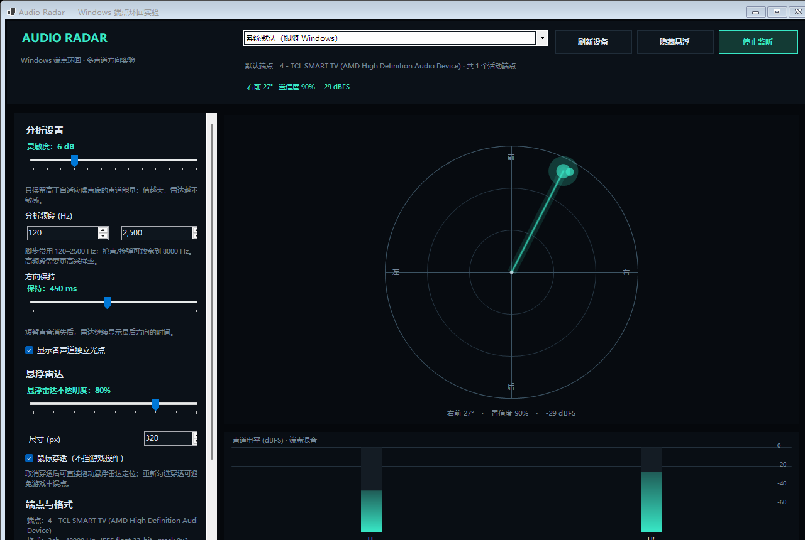
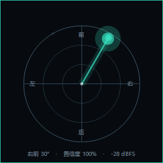

<p align="center">
  <a href="README.zh-CN.md"></a>
  <a href="README.md"></a>
</p>

<h1 align="center">Audio Radar</h1>

<p align="center">
  A Windows endpoint-loopback audio direction radar for accessibility, experiments, and DeepSeek Harness workflows.
</p>

<p align="center">
  
  
  
  
</p>



Audio Radar reads the **final mix sent to a Windows render endpoint** through WASAPI loopback, estimates direction from discrete multichannel energy, and draws a live radar. It does **not** inject into games, read game memory, or capture a game process.

The project was built and tested while working with **DeepSeek Harness 44.7.0**. Audio Radar is a standalone Windows application, not a DSH plugin, and has no DSH API dependency.

## Why

Hearing loss — especially single-sided deafness — can remove the directional cues that competitive and immersive games rely on. Audio Radar is an accessibility-oriented experiment:

- Listen to the same Windows mix the player hears.
- Show direction as a radar, text, and optional overlay.
- Keep the implementation external and auditable.
- Avoid anti-cheat-sensitive process injection.

## Features

- **Default endpoint discovery** — follows the Windows default render endpoint; no hard-coded HDMI device.
- **Endpoint loopback only** — shared-mode WASAPI, no process hook, no DLL injection, no memory reading.
- **Generic channel-layout support** — 2.0, 5.1, 7.1, 5.1.2, 7.1.2, 5.1.4, 7.1.4 and custom `WAVEFORMATEXTENSIBLE` masks.
- **Direction estimation** — channel-band energy and 3D unit vectors, including elevation when the endpoint exposes Top channels.
- **Adaptive noise floor** — transient emphasis, confidence score, and direction hold.
- **Semi-transparent always-on-top overlay** — opacity, size, click-through, and a 33 ms topmost re-assert loop.
- **Channel meters** — per-channel dBFS display.
- **Diagnostics** — endpoint probe, algorithm self-test, capture test, screenshot mode.

## Install

### Option 1: GitHub Release (recommended)

1. Open the [Releases](https://github.com/MicroHEROX/audio-radar/releases) page.
2. Download `AudioRadar-1.0.0-win-x64.zip`.
3. Extract it to a folder you control.
4. Run `AudioRadar.exe`.

The release artifact is self-contained for Windows x64. Only runtime files are included in the ZIP; documentation is **not** installed with the app.

### Option 2: npm

```bash
npm install -g audio-radar-dsh
audio-radar
```

The npm package is a small launcher. It downloads the matching GitHub Release asset on first run and stores it under `%LOCALAPPDATA%\AudioRadar`. Documentation is not included in the npm package.

### Option 3: Build from source

Requirements: Windows 10 2004+ x64, .NET 8 SDK.

```powershell
git clone https://github.com/MicroHEROX/audio-radar.git
cd audio-radar
dotnet run
```

## Quick start

1. Start the app.
2. Leave the endpoint selector on **System default (follow Windows)** or choose a specific endpoint.
3. Click **Start listening**.
4. Play audio. The radar shows the estimated direction; the bottom meters show channel levels.
5. Click **Overlay** to open the semi-transparent radar.
6. Keep **Click-through** enabled while playing; disable it temporarily to drag the overlay.

For a 360° radar, the endpoint must expose a discrete multichannel bed (5.1/7.1 or better), and the game must output to that bed. Stereo endpoints can only resolve left/right.

## The overlay



- Borderless, rounded, semi-transparent window.
- Always-on-top, with a 33 ms topmost re-assert loop.
- Attempts the undocumented `SetWindowBand(SYSTEM_TOOLS)` window band; if Windows denies it, the UI shows `TopMost fallback` and keeps using the topmost re-assert loop.
- Click-through uses `WS_EX_TRANSPARENT | WS_EX_NOACTIVATE`.
- `Ctrl`-free operation: no global hotkey is required.

**Exclusive fullscreen is a hard limit for any external overlay.** Use borderless/windowed mode if the game covers the overlay. RTSS OSDs that draw directly into the game's swapchain are also outside the control of an external window.

## Supported audio layouts

| Layout | Channels | Height | Notes |
|---|---:|---|---|
| Stereo 2.0 | 2 | No | Left/right only; front/back unknown |
| 5.1 | 6 | No | Front + rear |
| 7.1 | 8 | No | Front + side + rear |
| 5.1.2 | 8 | Yes | Top front pair |
| 7.1.2 | 10 | Yes | Top front pair |
| 5.1.4 | 10 | Yes | Top front + top rear |
| 7.1.4 | 12 | Yes | Top front + top rear + sides |

The app reads the speaker mask from `WAVEFORMATEXTENSIBLE.dwChannelMask`; it does not assume a fixed channel order.

## Dolby / Atmos reality check

Dolby Atmos for home theater can expose a **7.1 PCM bed** to WASAPI. The height objects are usually carried as Dolby MAT metadata and are not visible as separate PCM channels through endpoint loopback.

Therefore:

- 7.1 bed analysis works.
- 5.1.2/7.1.4 height analysis works only if the endpoint actually exposes those PCM channels.
- A true Atmos object-level radar would require MAT/object metadata access or game/audio-engine integration. That is outside this project.

## What this project does

- Reads the Windows endpoint mix.
- Estimates one dominant direction and a confidence score.
- Tracks a short direction hold; shows channel-level blips.
- Displays a main radar and an external overlay.
- Handles dynamic channel masks and multichannel PCM capture.
- Provides reproducible diagnostics and a self-test.

## What this project does not do

- It does not separate arbitrary simultaneous sources from a mixed endpoint.
- It does not identify players, enemies, or game objects.
- It does not measure distance in meters.
- It does not decode Dolby MAT objects or Atmo height metadata.
- It does not inject into games or bypass anti-cheat.
- It does not guarantee overlay visibility in exclusive fullscreen.
- It is not a medical device or a replacement for hearing aids/cochlear implants.

## Routes: viable and not viable

### Viable

- **Discrete 5.1/7.1 endpoint loopback** — direct per-channel analysis; best accuracy.
- **7.1.4 PCM endpoint** — height channels visible; elevation radar possible.
- **Stereo fallback** — left/right only; useful but limited.
- **External overlay** — no injection; works in borderless/windowed games.
- **Synthetic test signals** — reproducible validation of layout and direction.
- **Event classification** — footsteps/gunshots/reloads can be distinguished with more DSP/ML work.
- **Multiple instantaneous blips** — top-K channel peaks can be displayed without full tracking.

### Not viable (or not reliable)

- **Any simultaneous source separation from one mixed endpoint** — two sources in the same channel/band are merged.
- **Stable multi-target identity through crossings** — possible only under favorable separation; not guaranteed.
- **Atmos height objects from MAT** — endpoint loopback cannot see them.
- **Player identity/distance** — no game state or object metadata.
- **Covering exclusive fullscreen without injection** — external windows cannot guarantee this.
- **Guaranteed anti-cheat safety in multiplayer** — external visualization can still violate game rules.

## Privacy and security

- Audio is processed in memory; the app does not record or upload it.
- No telemetry, analytics, accounts, or network calls are made by the radar itself.
- No API keys or local machine identifiers are stored in this repository.
- The app does not modify game files or install drivers.
- npm installation downloads a GitHub Release asset; source builds use the .NET SDK.

## Uninstall

### Audio Radar (ZIP / source build)

1. Close the app.
2. Delete the extracted folder.
3. If you used the npm launcher, remove its cache:

```powershell
Remove-Item -Recurse -Force "$env:LOCALAPPDATA\AudioRadar" -ErrorAction SilentlyContinue
```

### Audio Radar (npm)

```bash
npm uninstall -g audio-radar-dsh
```

Then delete `%LOCALAPPDATA%\AudioRadar` if it exists.

### Optional Kimi Browser Extension

Audio Radar does **not** depend on Kimi. If you installed the Kimi Browser Extension for browser automation, remove it separately:

```powershell
& "$env:USERPROFILE\.kimi-webbridge\bin\kimi-webbridge.exe" uninstall
```

Then remove the **Kimi** extension from `chrome://extensions`.

## Documentation

- [Installation and troubleshooting](docs/INSTALL.md)
- [Architecture](docs/ARCHITECTURE.md)
- [API and CLI reference](docs/API.md)
- [Glossary](docs/GLOSSARY.md)
- [Solutions and trade-offs](docs/SOLUTIONS.md)
- [Testing](docs/TESTING.md)
- [Security and privacy](docs/SECURITY.md)
- [Release process](docs/RELEASE.md)

These documents live in the GitHub repository. They are deliberately excluded from the runtime ZIP and npm package.

## Version and compatibility

| Item | Value |
|---|---|
| Audio Radar | 1.0.0 |
| Tested OS | Windows 10.0.26300 x64 |
| Runtime | .NET 8 (source); self-contained release |
| DeepSeek Harness | 44.7.0 (test environment) |
| DSH API dependency | None |
| License | MIT |

## Acknowledgments

- **DeepSeek** and **DeepSeek Harness** — the environment and workflow that motivated this experiment.
- **Microsoft Windows Core Audio / WASAPI** — endpoint enumeration, loopback capture, and audio format documentation.
- **.NET 8 / Windows Forms** — the runtime and UI stack.
- **Kimi Browser Extension / WebBridge** — used during release automation, not required at runtime.
- **VisualAudioOverlay** — an earlier open-source exploration of accessibility audio radars that informed the problem framing. No code was copied.
- The open-source community around Windows audio tooling, accessibility, and game audio research.

## License

MIT. See [LICENSE](LICENSE).
